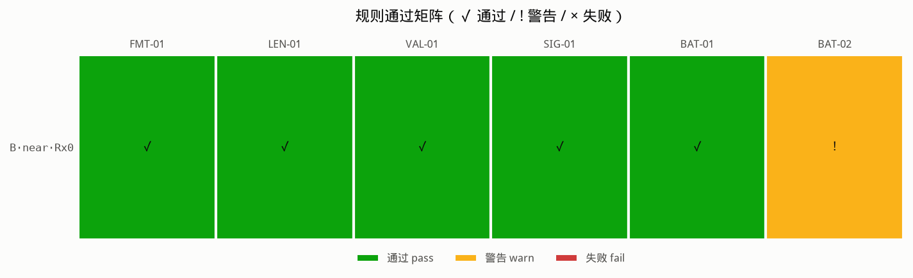
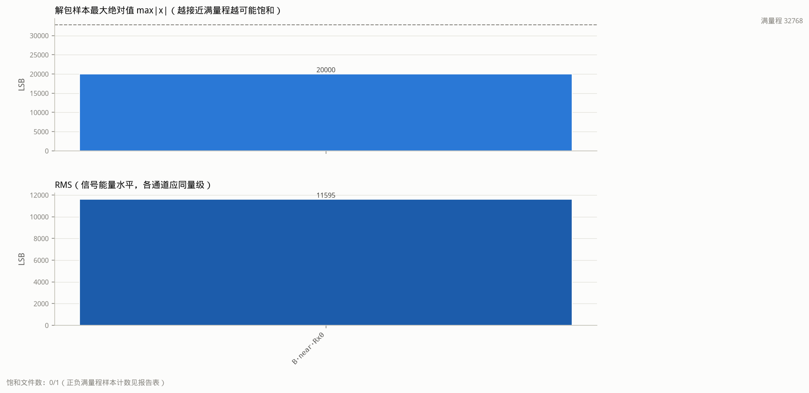

# CTSAI-A100 ADC 批次完整性与质量审计工具（a100-adc-audit）

对 CTSAI-A100 采集的 ADC 文本数据做**离线完整性与质量审计**的 Python 工具：识别两种
文件布局（无头 / 三字段头）、对照 `sensor_config_initN.hxx` 配置核对载荷长度、
逐 token 校验数值合法性、按官方 MATLAB 语义解包 int16 样本并统计饱和/常值游程/
全零 chirp/DC/RMS，再做跨批次 sha256 去重与同批通道一致性检查。

**核心卖点：把"静默修补"变成"显式报告"。** 仓内现有校验器
（`community/projects/a100-matlab-adc-pipeline-validation/validator/run_reference_validation.py`）
在 `值数 == 期望+1` 时静默执行 `values[1:]` 丢首值；本工具对每一次修补
（丢弃多余值、补零）都写明**丢的是哪个位置、值是多少、依据什么规则**（见 LEN-01）。

本项目为纯离线数据分析，**未做任何硬件实测**。

## 1. 项目目标

- 在不依赖 MATLAB 的前提下，回答"这批 ADC 数据能不能安全地喂给信号处理流水线"；
- 对仓内两种 ADC 文本布局给出统一的显式审计：格式、长度、数值、信号质量、批次一致性；
- 每条规则有 id、严重级别、通过/警告/失败三态；退出码可被 CI 直接消费
  （0=无失败，1=存在失败；`--strict` 下警告也返回 1）；
- 提供故障注入单元测试，保证工具本身对截断、坏 token、重复通道等故障分级正确、
  对完好文件不误报。

## 2. 数据说明

审计对象全部来自**本仓库自带的官方示例数据**（未复制进本项目，报告用仓库相对路径引用）：

| 组 | 目录（仓库相对路径） | 布局 | 文件 |
|---|---|---|---|
| A | `ADC数据采集/示例adc数据和结果/` | 无头 | `adc_近波_20260512141857_f1_{0..3}_*.txt`、`adc_远波_20260512135827_f0_{0..3}_*.txt` |
| B | `ADC数据采集/matlab_signal_processing_platform_231023_for_txt_A100/data/` | 无头 / 三字段头 | `adc_test_20260512141857_f1_{0..3}_*.txt`、`adc_test_20260527115{033,041,050,059}_Pf0_Rx{0..3}.txt` |

- A 组与 B 组 f1 文件共 8 个；B 组 Pf0 文件以三字段头 `<rx>,<rng_nfft>,<nchirp>,`
  开始（实测 `0,1024,256` 等）。
- 配置只读输入：`ADC数据采集/matlab_signal_processing_platform_231023_for_txt_A100/cfg/CTASI-A100配置/sensor_config_init0.hxx`
  （远波 f0：76.3 GHz / 300 MHz / 256 chirp / rng_nfft 1024 / vel_nfft 256 / ADC 25 MHz / 采样窗 2–42.8 µs）
  与 `sensor_config_init1.hxx`
  （近波 f1：76.119 GHz / 750 MHz / 128 chirp / rng_nfft 2048 / vel_nfft 128 / 采样窗 2–104.4 µs）。
  两个 profile 的期望原始字数相同：`rng_nfft/2 × nchirp = 131072`（形状不同）。

16 个审计文件的 sha256（审计时实际校验，重复即 BAT-01 的输入）：

| 文件（仓库相对路径） | sha256 |
|---|---|
| `ADC数据采集/示例adc数据和结果/adc_近波_20260512141857_f1_0_14_19_05_965.txt` | `36db22359f0bc902022ec26a07a1a6cb2ed941f66f75729c42d01bf56c4d273c` |
| `ADC数据采集/示例adc数据和结果/adc_近波_20260512141857_f1_1_14_19_14_570.txt` | `4fb120427111cddaf220433bf85491a700633ca28e4b41d5ea20ee01707960ab` |
| `ADC数据采集/示例adc数据和结果/adc_近波_20260512141857_f1_2_14_19_23_170.txt` | `05f3a38d9297f35c7972d84d8f9e300b269457b3e6cd00e5f51d3172ac6c306e` |
| `ADC数据采集/示例adc数据和结果/adc_近波_20260512141857_f1_3_14_19_31_788.txt` | `134e89fb95ae8e2d7955163e888040ecf59fc3895c21841debc07fb51127e7bb` |
| `ADC数据采集/示例adc数据和结果/adc_远波_20260512135827_f0_0_13_58_36_748.txt` | `bba39d6f30c7c1530e85a2bf7b2509278fbcf03c4a025cb5978a3efdefdfb3a7` |
| `ADC数据采集/示例adc数据和结果/adc_远波_20260512135827_f0_1_13_58_45_367.txt` | `33d6b42ec6458934f0a2d66d547678e6604901b7fb26c7bfee44aba3a0d7448d` |
| `ADC数据采集/示例adc数据和结果/adc_远波_20260512135827_f0_2_13_58_53_977.txt` | `c58910a1705586758362c348f6cd347d44ea8ee7d54fe2771193bc23671c3a70` |
| `ADC数据采集/示例adc数据和结果/adc_远波_20260512135827_f0_3_13_59_02_596.txt` | `80ebc8a7f1735612b1f91292fefd083058acabc00980c1ed7a00739e5691226f` |
| `ADC数据采集/matlab_signal_processing_platform_231023_for_txt_A100/data/adc_test_20260512141857_f1_0_14_19_05_965.txt` | `36db2235…4d273c`（与 A 近波 Rx0 相同） |
| `ADC数据采集/matlab_signal_processing_platform_231023_for_txt_A100/data/adc_test_20260512141857_f1_1_14_19_14_570.txt` | `4fb12042…7960ab`（与 A 近波 Rx1 相同） |
| `ADC数据采集/matlab_signal_processing_platform_231023_for_txt_A100/data/adc_test_20260512141857_f1_2_14_19_23_170.txt` | `05f3a38d…c6c306e`（与 A 近波 Rx2 相同） |
| `ADC数据采集/matlab_signal_processing_platform_231023_for_txt_A100/data/adc_test_20260512141857_f1_3_14_19_31_788.txt` | `134e89fb…27e7bb`（与 A 近波 Rx3 相同） |
| `ADC数据采集/matlab_signal_processing_platform_231023_for_txt_A100/data/adc_test_20260527115033_Pf0_Rx0.txt` | `c8c112139a1d72f9055f115204e4f97aae681db2172a2feee5cc76f2f284cb5f` |
| `ADC数据采集/matlab_signal_processing_platform_231023_for_txt_A100/data/adc_test_20260527115041_Pf0_Rx1.txt` | `ea15547d808e671474f5e8a94060f1c06627315d568c6f656c20e272ea9c7202` |
| `ADC数据采集/matlab_signal_processing_platform_231023_for_txt_A100/data/adc_test_20260527115050_Pf0_Rx2.txt` | `7a5ad0f39cb829dd2a3a4289eddf65f682a69e0ad07631bd4e32648bc88a65bf` |
| `ADC数据采集/matlab_signal_processing_platform_231023_for_txt_A100/data/adc_test_20260527115059_Pf0_Rx3.txt` | `e30d54914accca261d9327291a2c4c92fac026018392d4e2d40124734662add2` |

**声明**：以上数据均为仓内官方示例数据的离线分析结果，本项目未做硬件实测，
也不对采集链路（USB 传输层等）的正确性作任何断言。

## 3. 审计规则

| id | 规则 | 说明 | 触发级别 |
|---|---|---|---|
| FMT-01 | 格式识别与三字段头交叉核对 | 无头 vs `<rx>,<rng_nfft>,<nchirp>` 头；头字段须与配置一致；文件名 f0/f1/Pf0/Pf1/近波/远波 标记须与配置 profile 一致 | 错误（头/profile 不一致）；警告（无法判断 profile） |
| LEN-01 | 载荷长度审计（显式修补报告） | 实际合法载荷 vs 期望 `rng_nfft/2×nchirp`；多余/缺失值的数量、位置（首/尾）、数值与修复动作（截断/补零）全部显式输出 | 错误（多余非零值、任何缺失）；警告（尾部多余零值） |
| VAL-01 | 数值合法性 | 每个 token 必须可解析为 uint32（0..2^32-1）；非数值/负数/越界逐个列出位置与原值 | 错误（存在任何非法 token） |
| SIG-01 | 信号质量统计 | 按官方 `adc_mem_2_real_fixed.m` 语义解包 int16 后：饱和计数（±32767/-32768）、最长常值游程、全零 chirp、DC、RMS。阈值：饱和率 ≥0.1% 警告、≥1% 错误；全零 chirp 警告（全零文件错误）；游程 ≥ rng_nfft（整 chirp 常值）警告 | 错误 / 警告（见左） |
| BAT-01 | 跨批次 sha256 去重 | 同一内容出现在多个批次（目录/波形组）→ 报"重复批次"并列出全部位置 | 警告 |
| BAT-02 | 同批通道一致性 | 按（目录, profile）分批：Rx 序号应完整（0..N-1）、不重复；三字段头 rx 与文件名一致；同批不同 Rx 内容不得相同 | 错误（重复 Rx / 头与文件名不符 / 同批内容相同）；警告（缺通道） |

统计口径：修复引入的补零不参与质量统计（不算全零 chirp、不稀释 RMS），
只有真实载荷参与 SIG-01。

## 4. 开发环境

- WSL Ubuntu 24.04（Windows 11 宿主），Python **3.12.3**
- numpy 2.5.3、matplotlib 3.11.2、pytest 9.1.1（共享 venv，无其他依赖）
- **无 MATLAB 依赖**（MATLAB 参考实现 `adc_mem_2_real_fixed.m` / `load_adc_data.m`
  仅作为解包与补零/截断语义的对照规范）
- 不需要网络；不需要雷达硬件

## 5. 运行方法

在本目录（`community/projects/a100-adc-audit/`）下：

```bash
# 单测（含故障注入回归），预期 38 passed
/home/cnj/openSource/.venv-a100/bin/python -m pytest tests/ -q

# 对仓内两组真实数据（16 文件）审计，产出 results/ 与 figures/
PYTHONPATH=src python -m adc_audit \
  --data-dir '../../../ADC数据采集/示例adc数据和结果' \
  --data-dir '../../../ADC数据采集/matlab_signal_processing_platform_231023_for_txt_A100/data' \
  --config '../../../ADC数据采集/matlab_signal_processing_platform_231023_for_txt_A100/cfg/CTASI-A100配置/sensor_config_init0.hxx' \
  --config '../../../ADC数据采集/matlab_signal_processing_platform_231023_for_txt_A100/cfg/CTASI-A100配置/sensor_config_init1.hxx' \
  --json results/adc_audit_report.json \
  --md   results/adc_audit_report.md \
  --figures-dir figures
```

`--data-dir` / `--config` 均可重复；配置按文件名 f0/f1 标记自动匹配（只给一份配置时
作为回退并对 profile 不符发警告）。预期输出（节选）：

```text
adc_audit: 审计 16 个文件，8 条批次结论
  [!] A·near·Rx0  ADC数据采集/示例adc数据和结果/adc_近波_..._f1_0_....txt  FMT-01:✓ VAL-01:✓ LEN-01:! SIG-01:✓
  ...
  [!] BAT-01 重复批次：sha256=36db22359f0b… 的同一内容出现在 2 个批次 (data/f1, 示例adc数据和结果/f1)：A·near·Rx0 @ 示例adc数据和结果/f1; B·near·Rx0 @ data/f1
  [✓] BAT-02 批次 data/f0: 4 个文件。Rx 序号完整 (0..3) 且内容互不相同
规则统计  FMT-01:16✓/0!/0✗  LEN-01:0✓/16!/0✗  VAL-01:16✓/0!/0✗  SIG-01:16✓/0!/0✗  BAT-01:0✓/4!/0✗  BAT-02:4✓/0!/0✗
总体: 失败 0，警告 20
退出码 0（0=无失败，1=存在失败）
```

## 6. 结果展示

完整报告：`results/adc_audit_report.json`（机器可读）与
`results/adc_audit_report.md`（人读，含每文件明细）。16 文件摘要：

| # | 标签 | 文件 | 格式 | 载荷/期望 | 饱和率 | 最长游程 | 全零chirp | DC | RMS | 总体 |
|---:|---|---|---|---|---:|---:|---:|---:|---:|---|
| 1 | A·near·Rx0 | `…/示例adc数据和结果/adc_近波_…_f1_0_….txt` | 无头 | 131073/131072 +1 | 0.0000% | 4 | 0/128 | 4.2 | 220.3 | warn |
| 2 | A·near·Rx1 | `…/示例adc数据和结果/adc_近波_…_f1_1_….txt` | 无头 | 131073/131072 +1 | 0.0000% | 4 | 0/128 | -7.8 | 562.1 | warn |
| 3 | A·near·Rx2 | `…/示例adc数据和结果/adc_近波_…_f1_2_….txt` | 无头 | 131073/131072 +1 | 0.0000% | 4 | 0/128 | 3.7 | 533.2 | warn |
| 4 | A·near·Rx3 | `…/示例adc数据和结果/adc_近波_…_f1_3_….txt` | 无头 | 131073/131072 +1 | 0.0000% | 4 | 0/128 | -8.4 | 522.4 | warn |
| 5 | A·far·Rx0 | `…/示例adc数据和结果/adc_远波_…_f0_0_….txt` | 无头 | 131073/131072 +1 | 0.0000% | 5 | 0/256 | 2.1 | 177.9 | warn |
| 6 | A·far·Rx1 | `…/示例adc数据和结果/adc_远波_…_f0_1_….txt` | 无头 | 131073/131072 +1 | 0.0000% | 5 | 0/256 | -6.6 | 435.2 | warn |
| 7 | A·far·Rx2 | `…/示例adc数据和结果/adc_远波_…_f0_2_….txt` | 无头 | 131073/131072 +1 | 0.0000% | 5 | 0/256 | -1.4 | 431.2 | warn |
| 8 | A·far·Rx3 | `…/示例adc数据和结果/adc_远波_…_f0_3_….txt` | 无头 | 131073/131072 +1 | 0.0000% | 5 | 0/256 | 5.1 | 391.8 | warn |
| 9–12 | B·near·Rx0–3 | `…/data/adc_test_…_f1_{0..3}_….txt` | 无头 | 131073/131072 +1 | 0.0000% | 4 | 0/128 | 同 1–4 | 同 1–4 | warn |
| 13 | B·far·Rx0 | `…/data/adc_test_20260527115033_Pf0_Rx0.txt` | 三字段头 | 131073/131072 +1 | 0.0000% | 5 | 0/256 | 8.0 | 130.9 | warn |
| 14 | B·far·Rx1 | `…/data/adc_test_20260527115041_Pf0_Rx1.txt` | 三字段头 | 131073/131072 +1 | 0.0000% | 4 | 0/256 | 10.2 | 205.6 | warn |
| 15 | B·far·Rx2 | `…/data/adc_test_20260527115050_Pf0_Rx2.txt` | 三字段头 | 131073/131072 +1 | 0.0000% | 5 | 0/256 | 5.8 | 169.3 | warn |
| 16 | B·far·Rx3 | `…/data/adc_test_20260527115059_Pf0_Rx3.txt` | 三字段头 | 131073/131072 +1 | 0.0000% | 5 | 0/256 | 15.1 | 163.2 | warn |

图表：

- 规则通过矩阵（16 文件 × 6 规则）：`figures/rule_matrix.png`
- 质量指标（每文件 max|x| 对满量程 32768 的余量 + RMS）：`figures/quality_metrics.png`





### 关键发现

1. **全部 16 个文件都比配置期望恰多 1 个尾零**（载荷 131073 = 131072 + 1，末值为 0，
   首值为非零信号）。LEN-01 对每个文件显式输出："尾部多余 1 个零值（载荷索引
   131072..131072，值全为 0）→ 截断修复：丢弃这些尾零后继续分析"。相比之下，现有
   校验器在同样情况下静默 `values[1:]` **丢弃首值**——首值是有效非零样本（如 A·near·Rx0
   首字 4287954824），依据"末值为 0"的证据应丢弃尾值而非首值。
2. **重复批次**：A 组近波 4 文件与 B 组 f1 4 文件 sha256 逐一相同（同一批数据被两个
   目录重复收录），BAT-01 报 4 条"重复批次"警告——这是跨批次去重的真实演示，
   也是数据管理提示（示例数据的实际独立批次为 12 个文件，而非 16 个）。
3. **三字段头与配置交叉核对通过**：B 组 Pf0 文件头 `(rx,1024,256)` 与 init0 的
   rng_nfft=1024 / nchirp=256 一致，头部 rx 序号与文件名 Rx 序号一致。
4. **信号质量整体健康、余量很大**：饱和 0 个样本（max|x| ≤ 1972 ≈ 6% 满量程）、
   无全零 chirp、最长常值游程 ≤5、DC 偏置 |·| ≤ 15.1 LSB、RMS 130.9–562.1 LSB。
   增益仍有较大上调空间（约 4 倍以上才会接近饱和）。
5. **两 profile 期望字数相同但形状不同**：远波 f0 理论采样窗 1020 样本 < rng_nfft 1024
   （每 chirp 尾部 4 个补零样本，与观测到的最长短零游程 4–5 一致）；近波 f1 理论窗
   2560 样本 > rng_nfft 2048（平台按 rng_nfft 截取）。两者期望字数同为 131072，
   长度审计无法区分二者，需结合 FMT-01 的头/文件名信息。

## 7. 局限

- **不能凭末尾零推定全部填充策略**：LEN-01 的"尾部多余零值"判定依据是末 k 个值全零
  且首部为非零信号；若采集端在其他位置插入零（如首部填充、按 chirp 填充），无参考
  批次时无法区分"多余尾零"与"信号本身的零段"，工具只能显式报告所见事实。
- **未覆盖 USB 传输层错误**：审计对象是已落盘的文本文件，USB/CAN 传输过程中的丢包、
  重传、错序若未反映到文本内容（如长度不变但内容错）则无法检出。
- 头识别是启发式（首值 ≤15 且后两值落在 FFT/chirp 工程区间）；对非常规布局可能误判，
  判据在 `loader.py` 中显式可查。
- 未做端到端信号处理验证（Range/Doppler 谱）——那属于
  `a100-matlab-adc-pipeline-validation` 项目的范畴。

## 8. 与现有社区项目的关系

- 与 `community/projects/a100-matlab-adc-pipeline-validation/` 互补且差异化：该校验器
  做信号处理结果的数值验证，遇到 `期望+1` 长度时**静默丢弃首值**；本项目做采集批次的
  完整性/质量审计，把同类修补变成**显式分级报告**（位置、数值、规则、修复动作），
  并新增批次去重与通道一致性检查。
- 与开放中的 PR #66（`fix(community): reject non-finite ADC payloads`）和
  PR #77（`docs: document both ADC session and flat file layouts`）主题不重叠：二者
  修改现有校验器/文档，本项目是新增独立审计工具，且不修改任何现有文件。

## 9. 作者信息

- 作者：chennaji9
- 许可：随仓库主 LICENSE
- 数据来源：CTSAI-A100 仓库官方示例数据（离线分析，未做硬件实测）
