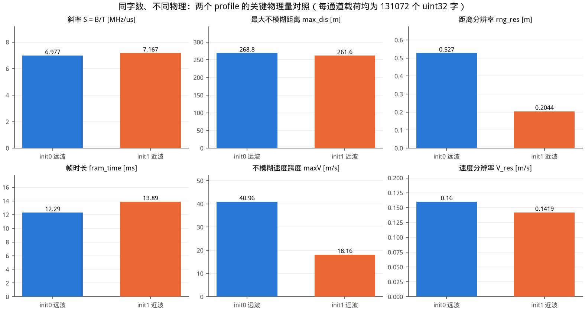
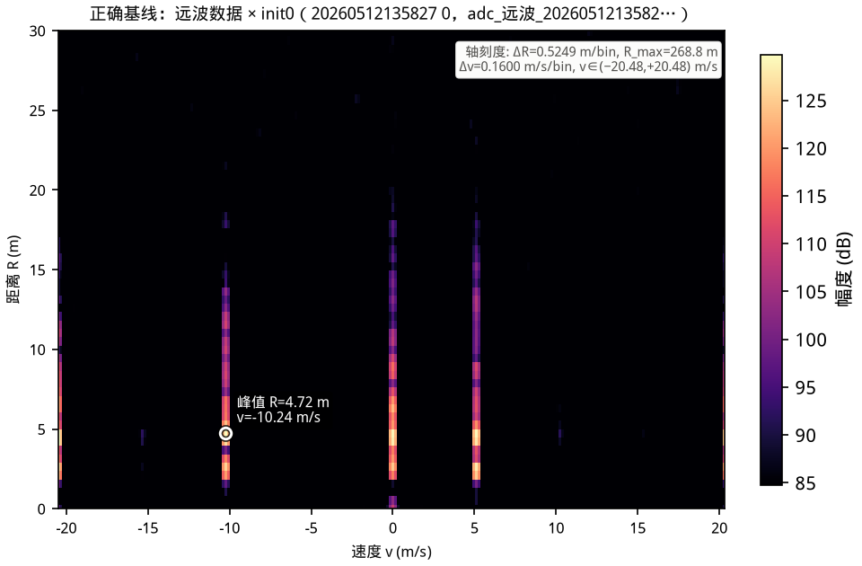
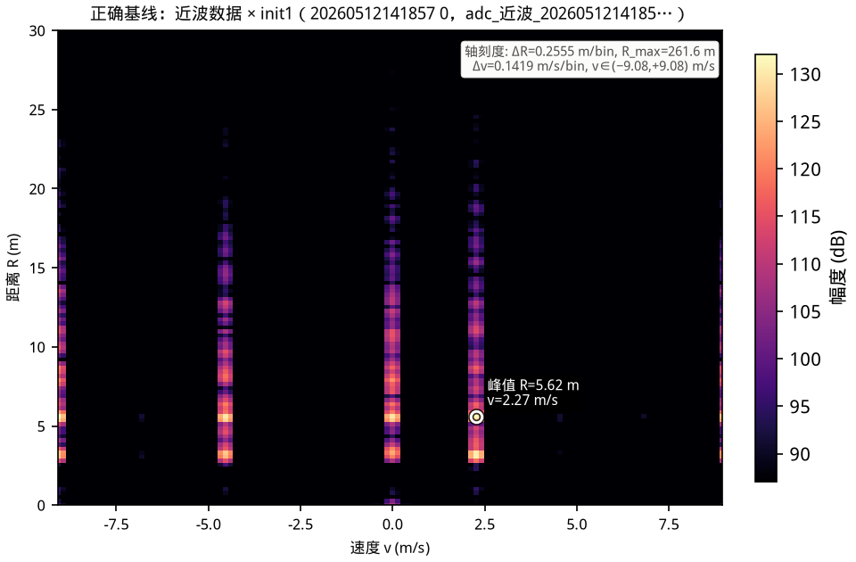
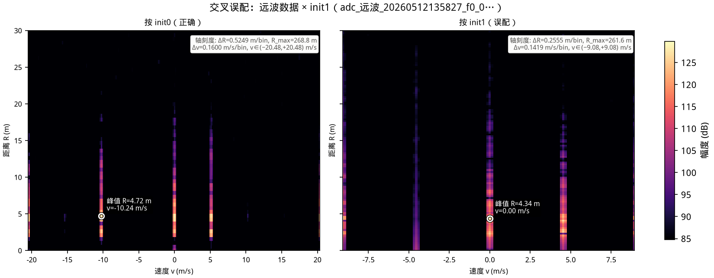
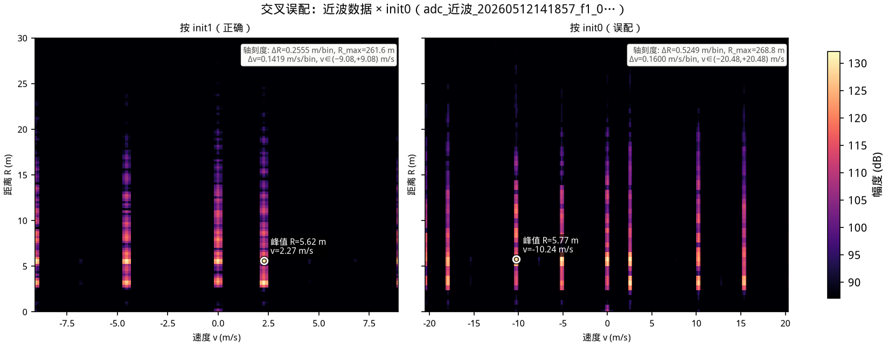
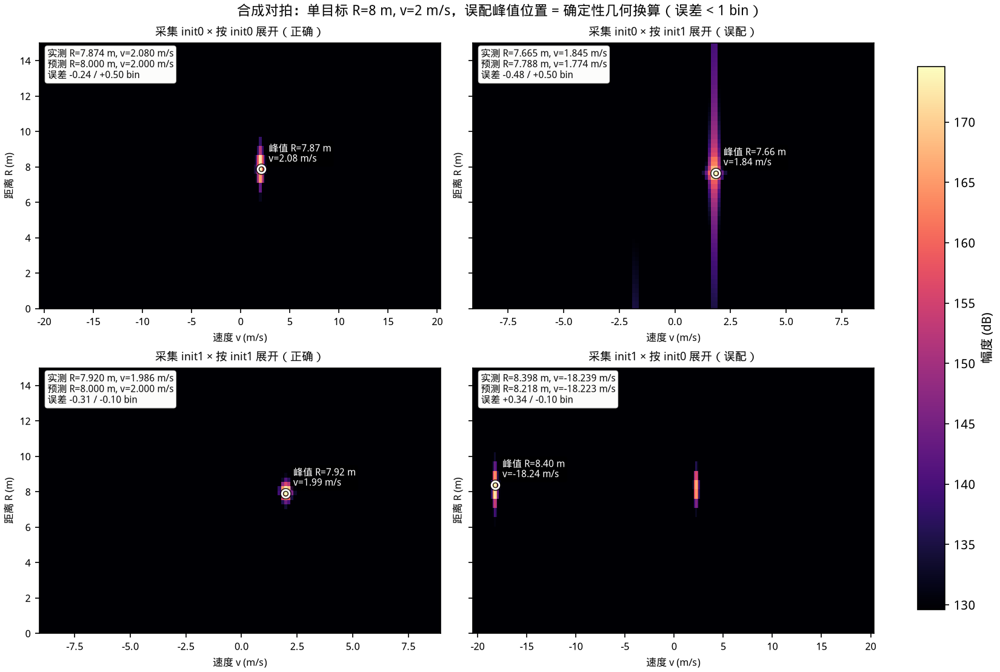
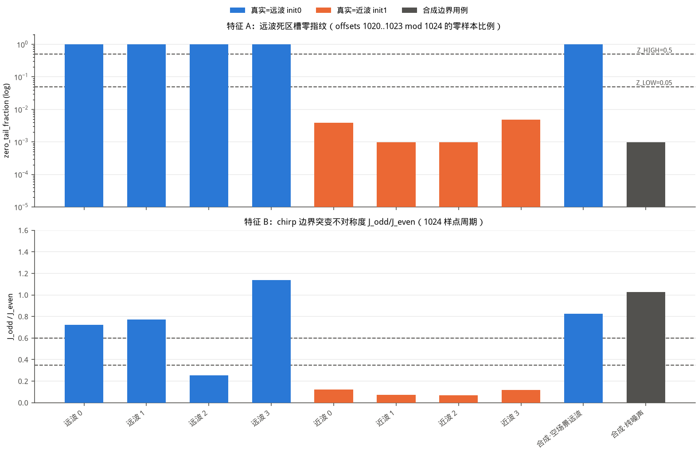

# A100 近/远波 Profile 误配的后果与检测（a100-profile-sensitivity）

一个纯离体的 Python 复现实验：**当 CTSAI-A100 的 ADC 数据被错误的 sensor profile
（近波 init1 / 远波 init0）解释时，Range–Doppler 谱会发生什么，以及如何在不看文件名
的前提下自检数据属于哪个 profile**。

本项目的动机是一个很容易踩中的陷阱：近波与远波两组配置**每通道期望的原始字数完全相同
（131072 个 uint32）**，但形状与物理参数完全不同——仅凭"值数对得上"无法发现用错了配置，
reshape 会静默成功，谱图也能画出来，只是**距离轴/速度轴的物理刻度全错**。

> 诚实红线：本项目的两组公开数据来自**不同采集场景**，不能用于比较"近波好还是远波好"。
> 一切结论仅限于"同一份数据被错误配置解释时会发生什么"。

---

## 1. 项目目标

1. **参数对照**：按官方 `get_radar_paramete.m` 的公式逐一推导两 profile 的物理量，
   展示"同字数、不同物理"；
2. **正确基线**：远波数据×init0、近波数据×init1 的 RV 谱（物理轴：距离 m、速度 m/s）；
3. **交叉误配**：远波数据×init1、近波数据×init0，量化谱峰表观位置的确定性偏差；
4. **合成对拍**：注入已知 (R, v) 的合成 ADC 帧，证明偏差是确定性几何换算而非噪声
   （误差 < 1 bin）；
5. **检测启发式**：仅用样本流/谱特征区分数据属于哪个 profile，在 8 个公开文件上
   8/8 判对，并给出适用边界（何时会失效）。

## 2. 数据说明

* 数据源：仓库自带官方示例（未做任何硬件实测，全部为离线分析）
  * ADC 文本：`ADC数据采集/示例adc数据和结果/adc_{远波|近波}_*_f{0|1}_{0..3}_*.txt`
    （每通道 8 个文件中的 4 个，共 8 个；无头单行逗号分隔 uint32，131073 值 =
    载荷 131072 + 1 个尾部零，首值即有效样本）
  * 传感器配置：`ADC数据采集/matlab_signal_processing_platform_231023_for_txt_A100/cfg/CTASI-A100配置/sensor_config_init{0,1}.hxx`
* sha256（保障可复现性，与本文结果一一对应）：

| 文件 | sha256 |
|---|---|
| adc_远波_20260512135827_f0_0_13_58_36_748.txt | bba39d6f30c7c1530e85a2bf7b2509278fbcf03c4a025cb5978a3efdefdfb3a7 |
| adc_远波_20260512135827_f0_1_13_58_45_367.txt | 33d6b42ec6458934f0a2d66d547678e6604901b7fb26c7bfee44aba3a0d7448d |
| adc_远波_20260512135827_f0_2_13_58_53_977.txt | c58910a1705586758362c348f6cd347d44ea8ee7d54fe2771193bc23671c3a70 |
| adc_远波_20260512135827_f0_3_13_59_02_596.txt | 80ebc8a7f1735612b1f91292fefd083058acabc00980c1ed7a00739e5691226f |
| adc_近波_20260512141857_f1_0_14_19_05_965.txt | 36db22359f0bc902022ec26a07a1a6cb2ed941f66f75729c42d01bf56c4d273c |
| adc_近波_20260512141857_f1_1_14_19_14_570.txt | 4fb120427111cddaf220433bf85491a700633ca28e4b41d5ea20ee01707960ab |
| adc_近波_20260512141857_f1_2_14_19_23_170.txt | 05f3a38d9297f35c7972d84d8f9e300b269457b3e6cd00e5f51d3172ac6c306e |
| adc_近波_20260512141857_f1_3_14_19_31_788.txt | 134e89fb95ae8e2d7955163e888040ecf59fc3895c21841debc07fb51127e7bb |

* **两组数据来自不同采集场景**（且均被近距离强反射/泄漏主导，>96% 能量落在前 50 个
  距离 bin）：因此本项目不比较两 profile 的探测性能优劣，只研究"用错配置的后果"。

## 3. 方法

### 3.1 处理链（与官方 MATLAB 平台逐行对齐）

| 步骤 | 官方参考 | 本项目实现 |
|---|---|---|
| uint32→2×int16 交错解包（高 16 位在前） | `init_function/adc_mem_2_real_fixed.m` | `pipeline.unpack_words` |
| 截断/补齐到 `rng_nfft/2 × nchirp` 字，按列优先 reshape `[rng_nfft/2, nchirp]`（快时间最快、chirp 最慢），转置为 `[样本, chirp]` | `init_function/load_adc_data.m` | `pipeline.load_cube` |
| `hann(adc_sample_num)` → Range-FFT(rng_nfft) 取前一半 → `hann(nchirp)` → Doppler-FFT(vel_nfft) | `FFT/do_fft_2d.m` | `pipeline.rv_image` |
| 物理量换算 | `init_function/get_radar_paramete.m` | `profiles.Profile`（含逐字符转写的 `ml_*` 对照实现，测试证明两者一致） |

说明：`do_fft_2d.m` 还除以 `rng_fft_scalar=0xff`、`vel_fft_scalar=0x3f`，是常数因子，
只整体平移 dB 底噪，本项目省略并在此注明。c 取 3e8 与官方脚本一致。

### 3.2 物理量换算公式（与 `get_radar_paramete.m` 一致）

| 物理量 | 公式（MATLAB 原式） | init0 远波 | init1 近波 |
|---|---|---|---|
| 有效采样点 `adc_sample_num` | `round((end-start)*adc_freq/dec)`（dec>1 时 +1），钳位到 `rng_nfft` | round(40.8×25)=**1020**（1024 槽位，尾部 4 个死槽） | round(102.4×25)=2560→钳位 **2048**（无死槽） |
| 斜率 S | `B*1e6 / (T*1e6)` [Hz/s] | 300/43 = 6.9767 MHz/us | 750/104.65 = 7.1667 MHz/us |
| 最大不模糊距离 `max_dis` | `3e8/2 * (adc_freq*1e6/2) / S / dec` | **268.750 m** | **261.625 m** |
| 距离分辨率 `rng_res` | `3e8/2 / ((B/T)*(end-start)) / 1e6` | **0.5270 m** | **0.2044 m** |
| RV 图距离 bin `rng_res_1dfft` | `max_dis / (rng_nfft/2)` | 0.5249 m/bin | 0.2555 m/bin |
| 帧时长 `fram_time` | `Tp*nchirp`（anti_velamb 关闭） | **12.288 ms** | **13.888 ms** |
| 不模糊速度跨度 `maxV` | `0.5*3e8/f0/1e9 * nchirp/fram_time` | **40.957 m/s**（±20.48） | **18.162 m/s**（±9.08） |
| 速度分辨率 `V_res=V_acu` | `maxV/vel_nfft` | 0.15999 m/s | 0.14189 m/s |
| **每通道期望字数** | `(rng_nfft/2)*nchirp` | **131072** | **131072** ← 陷阱 |

### 3.3 误配矩阵与表观位置换算

对"采集 profile=cap、按 assumed 展开"的任一组合：

* **距离轴**：差频 f_b 的谱峰落在 bin `k = f_b*rng_nfft/Fs`，而每 bin 代表
  `max_dis/(rng_nfft/2) = c*Fs/(2*S*rng_nfft)` 米——**rng_nfft 相消**，表观距离只取决于
  被假设的斜率：`R_app = f_b*c/(2*S_ass) = R_true * S_cap/S_ass`。
  * 近波数据按 init0 展开：×1.02723（+2.72%）；远波数据按 init1：×0.97349（−2.65%）。
* **速度轴（标称）**：错误 reshape 改变了 chirp 数，相邻（伪）chirp 的真实时间间隔变为
  `nchirp_cap*Tp_cap/nchirp_ass`，而处理器按 `Tp_ass` 解释：
  `v_app = v_true * (nchirp_cap/nchirp_ass)*(Tp_cap/Tp_ass)*(λ_ass/λ_cap)`
  * 近波→init0：×1.12753；远波→init1：×0.88690。
* **速度轴（半帧跳变，本项目的关键发现）**：近波数据按 init0 展开时，每个真实 chirp
  （2048 样点）被从**中点**切成两个伪 chirp，奇数伪 chirp 的起始相位比偶数超前
  `θ = 2π·f_b·(rng_nfft_ass/Fs)`——这是慢时间序列上的 **period-2 相位调制**，其谱把
  速度峰拆成"主分量"（权重 |1+e^{iθ}|）与"±半帧镜像分量"（权重 |1−e^{iθ}|，落在
  k∓vel_nfft/2）。**θ 取决于目标差频**：当 |1−e^{iθ}|>|1+e^{iθ}| 时主峰整体弹到
  ±maxV/2 位置。本例（R=8 m, v=+2 m/s）实测读数 **−18.24 m/s**——速度符号和量级
  全错。远波数据按 init1 展开没有该镜像（两个真实 chirp 拼成一个伪 chirp，只在记录
  中点有一次相位台阶，泄漏但不搬移谱峰）。

### 3.4 检测特征定义（启发式，非保证）

| 特征 | 定义 | 远波 init0 实测 | 近波 init1 实测 |
|---|---|---|---|
| A. 死区槽零指纹 `zero_tail` | offsets 1020..1023 (mod 1024) 处样本为精确 0 的比例（init0 每 chirp 槽只有 1020 个有效点，采集链将尾部 4 槽**零填充**；init1 钳位到满槽 2048，无死槽） | **1.0000**（4/4 文件） | 0.0010–0.0049（仅量化噪声偶零） |
| B. 边界突变不对称度 `click_asym` | 候选 1024 样点周期处，奇数倍位置与偶数倍位置的平均跳变 \|Δs\| 之比 `J_odd/J_even`（远波真实边界在每个 1024 倍数→两者同高；近波真实边界只落在 2048 倍数→奇数位置是 chirp 中段） | 0.256–1.139 | 0.070–0.121 |
| 判定规则 | `zero_tail≥0.5`→init0（高置信）；`<0.05` 且 `click_asym≤0.35`→init1（高置信）；灰区用 B 降级判定；两特征都无结构→**abstain（uncertain）** | | |

阈值由 8 个公开文件实测分布定出（0.05/0.5 与 0.35/0.6），见 `src/profile_sensitivity/detector.py`。

**探索过但不采用的特征（诚实记录）**：谱形态熵、远 bin 能量占比、"不可能速度"检查等
谱域特征在本数据上与**场景**强耦合而与 profile 弱耦合（两组场景不同，见 §2 红线），
进入判定会把场景差异误当 profile 差异，故只作为描述性统计输出
（`detector.spectral_descriptors`），不参与投票。同样，"近波数据按 init0 展开目标会落入
>max_dis 不可能区"在本配置对上不成立（两者 max_dis 仅差 2.7%，且表观距离只偏 ±2.7%，
远达不到越界）——任务书中的该示例启发式经核实不适用于本数据，如实说明。

## 4. 开发环境

* 硬件：无需（纯离线分析，未做任何雷达实测）
* OS：WSL Ubuntu 24.04（Windows 11 宿主）
* Python 3.12.3；numpy 2.5.3 / scipy 1.18.1 / matplotlib 3.11.2（Agg 后端出 PNG）/ pytest 9.1.1
* 不依赖任何仓外数据；数据与配置路径可由 CLI 参数覆盖，默认指向本仓库内官方路径

## 5. 运行方法

```bash
cd community/projects/a100-profile-sensitivity

# 测试（23 项，<2 s）
/path/to/python -m pytest tests/ -q

# 一键复现全部图表（固定种子 20260929，输出 figures/ 与 results/）
/path/to/python src/profile_sensitivity/cli.py
# 可选: --data-dir --hxx-dir --out-dir --seed --target R V
```

全部图表与表格均可由 CLI 确定性重生成；`results/run_summary.md` 汇总本次运行关键数值。

## 6. 结果展示

### 6.1 参数对照（"同字数、不同物理"）



完整逐公式表格见 [`results/parameter_comparison.md`](results/parameter_comparison.md)。
要点：两 profile 每通道载荷**同为 131072 字**；但距离分辨率差 2.58 倍（0.527 vs
0.204 m）、不模糊速度跨度差 2.26 倍（40.96 vs 18.16 m/s）、帧时长差 13%。

### 6.2 正确基线

| 远波数据 × init0 | 近波数据 × init1 |
|---|---|
|  |  |

（两组数据均为近距强反射主导的场景，主峰位于 2.6–5.6 m。）

### 6.3 交叉误配

| 远波数据 × init1（误配） | 近波数据 × init0（误配） |
|---|---|
|  |  |

表观距离偏差表（节选，完整见 [`results/apparent_shift.md`](results/apparent_shift.md)）：

| 文件 | 正确谱峰 | 误配谱峰 | R 比例(预测/实测) | 速度读数变化 |
|---|---|---|---|---|
| 远波 f0_0 | R=4.72 m, v=−10.24 | R=4.34 m, v=0.00 | 0.97349 / 0.919 | −10.24 → 0.00（越界混叠） |
| 远波 f0_1 | R=2.63 m, v=−10.24 | R=2.56 m, v=0.00 | 0.97349 / 0.973 | −10.24 → 0.00 |
| 近波 f1_0 | R=5.62 m, v=+2.27 | R=5.77 m, v=−10.24 | 1.02723 / 1.027 | +2.27 → −10.24（符号翻转） |
| 近波 f1_1 | R=3.07 m, v=−4.54 | R=3.15 m, v=0.00 | 1.02723 / 1.027 | −4.54 → 0.00 |

* **距离轴**：8/8 个文件的误配表观距离都与比例预测相差 ≤1 bin（多数 0.00 bin）——
  偏差小但**系统性**：每个目标都被悄悄搬移 ~±2.7%，且"分辨率/最大距离"的口头
  说明全部失真（声称 0.52 m 分辨率实际数据含 0.26 m 信息，反之亦然）。
* **速度轴**：8 行中 6 行主峰跳变（`peak_jump`）：或越界混叠归零（远波快速分量
  超出 init1 的 ±9.08 m/s），或半帧镜像翻转符号（近波 +2.27 → −10.24 m/s）。
  速度是误配中**破坏最严重**的维度。
* 具体错误结论演示：把近波数据当远波处理，一个 +2.3 m/s 的接近目标会被读成
  −10.2 m/s 的远离目标（方向、量级全错），而距离只偏 3%——肉眼几乎无法察觉。

### 6.4 合成对拍（确定性证明）



单目标 R=8 m, v=+2 m/s，四种组合全部 |误差| < 0.5 bin（完整表
[`results/synthetic_verification.md`](results/synthetic_verification.md)）：

| 采集 | 按 | kR | kV | R 实测/预测 (m) | v 实测/标称/跳变后预测 (m/s) |
|---|---|---|---|---|---|
| init0 | init0（正确） | 15 | 13 | 7.874 / 8.000 | 2.080 / 2.000 / 2.000 |
| init0 | init1（误配） | 30 | 13 | 7.665 / 7.788 | 1.845 / 1.774 / 1.774 |
| init1 | init1（正确） | 31 | 14 | 7.920 / 8.000 | 1.986 / 2.000 / 2.000 |
| init1 | init0（误配） | 16 | **−114** | 8.398 / 8.218 | **−18.239** / 2.255 / **−18.223**（半帧跳变） |

即：误配偏差是**可从两配置参数先验写出的确定性几何换算**（含半帧镜像的 θ 判据），
不是噪声或实现差异。

### 6.5 检测器输出



完整表见 [`results/detector_output.md`](results/detector_output.md)：

| 用例 | 真实 | zero_tail | click_asym | 判定 | 置信度 |
|---|---|---|---|---|---|
| 远波 f0_0..f0_3（4 文件） | init0 | 1.0000 | 0.256–1.139 | init0 | 高 |
| 近波 f1_0..f1_3（4 文件） | init1 | 0.0010–0.0049 | 0.070–0.121 | init1 | 高 |
| 合成·空场景远波（仅噪声+零死槽） | init0 | 1.0000 | 0.825 | init0 | 高 |
| 合成·纯噪声（无任何结构） | — | 0.0010 | 1.027 | **uncertain（弃权）** | — |

**公开文件 8/8 判对（全部高置信）**。特征 A 与场景无关（空场景仍判对）；特征 B 需要
真实 chirp 边界存在突变。

## 7. 结论（给社区的实用建议）

1. **处理 ADC 前先核对 profile**：字数校验（131072）对近/远波完全无区分力；
   至少应记录采集时的 hxx 版本/文件名并与处理端绑定。
2. **误配不是"崩溃"而是"静默错标"**：reshape 与 FFT 全部成功、谱图看似正常——
   距离悄悄偏 ±2.7%、分辨率/最大距离/帧时长口头值失真，而速度读数可能越界混叠或
   因半帧镜像**连符号都翻转**（+2 m/s 读成 −18 m/s）。
3. **两分钟自检**：对原始样本流跑一遍本项目检测器（`detector.detect_profile`）：
   看 offsets 1020–1023 (mod 1024) 的零样本比例（≈1 → 远波）与 1024 周期的边界突变
   不对称度（≈0.1 → 近波）。远波死槽零填充是采集链行为，与场景内容无关。
4. 检测启发式的**适用条件**：特征 A 依赖"死槽零填充"这一采集链行为（若未来固件
   改为填充随机数则会失效）；特征 B 依赖 chirp 边界存在可测突变。两者都无结构时
   检测器**弃权**而不是瞎猜。

## 8. 局限

* 检测器是**启发式不是保证**：只在 8 个公开文件 + 合成边界用例上验证过；未覆盖
  init2/init3 等其他配置组合，也未覆盖 AGC 削顶、深度饱和等极端波形。
* 纯噪声/无结构流会触发弃权（uncertain），此时只能回到元数据核对。
* 真实数据的速度轴对照受场景主导（两组数据的强反射分量不同），速度定量结论以
  §6.4 合成对拍为准；`peak_jump` 行如实标注而非强行解释。
* 官方 `do_fft_2d.m` 中的相位补偿/去零多普勒等被注释掉的分支未实现（与公开 MATLAB
  平台的活跃处理一致）。
* 未做硬件实测；所有"远波/近波"标签来自官方文件名与配置。

## 9. 与现有社区项目的关系

* `community/projects/a100-matlab-adc-pipeline-validation`：正确使用双 profile 完成
  MATLAB/NumPy 双实现验证，但**未研究误配的后果**；本项目补上"用错配置会发生什么 +
  如何自检"这一维度，处理链与其保持官方 MATLAB 语义一致。
* 与 open PR #77（ADC 数据布局文档）不重叠：那是文件布局说明，本项目是配置敏感性实验。
* `community/projects/a100-matlab-adc-signal-processing`：官方链路的 MATLAB 复现，
  本项目在其之上做交叉误配与检测实验。

## 10. 作者信息

* 作者：chennaji9
* 项目目录：`community/projects/a100-profile-sensitivity/`
* 数据类型：ADC（仓库公开示例）；开发环境：Python（WSL Ubuntu 24.04）
* 许可：随仓库主许可
