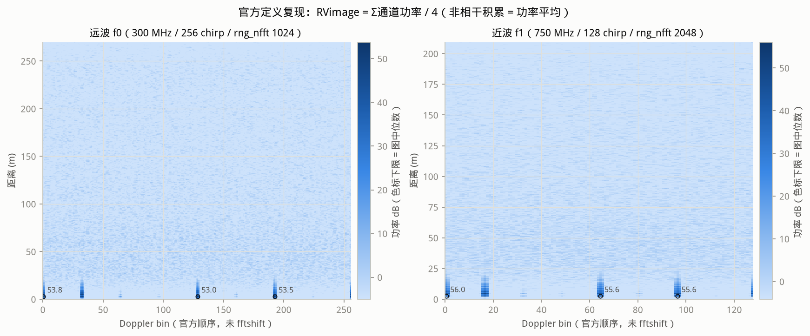
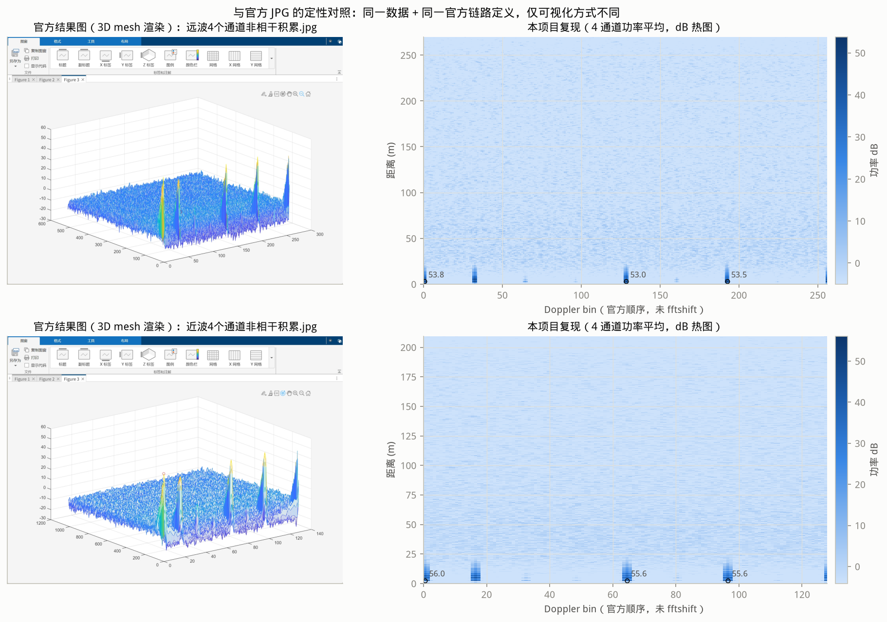
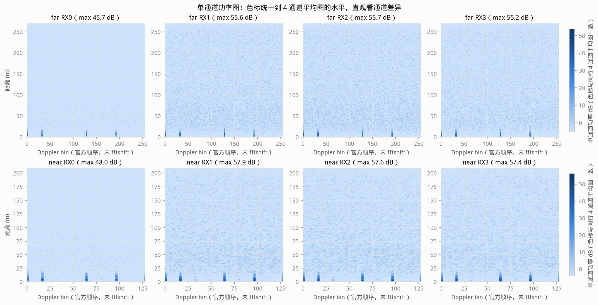
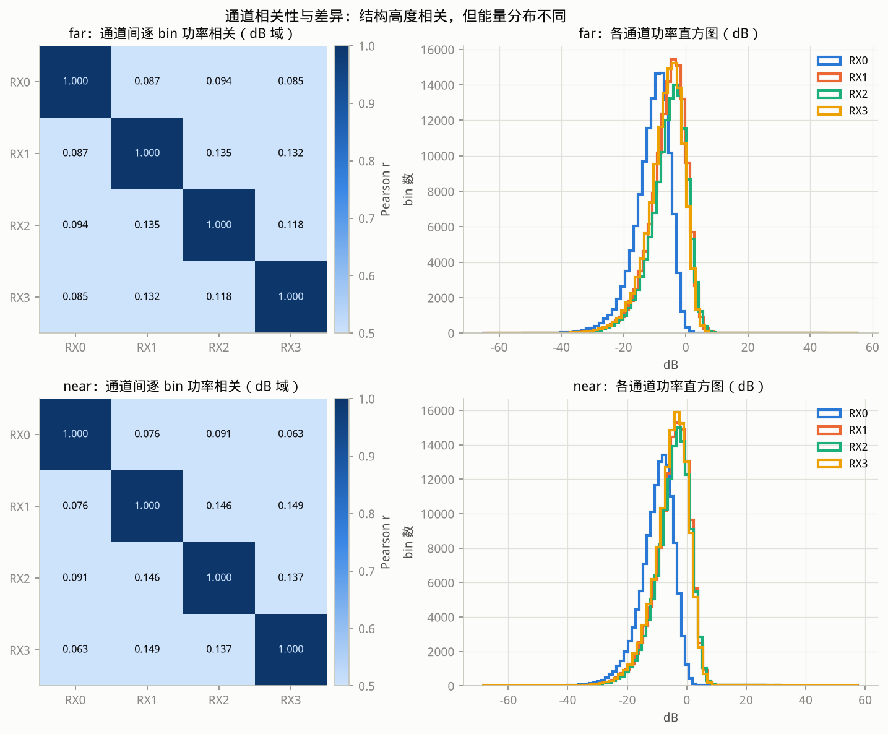
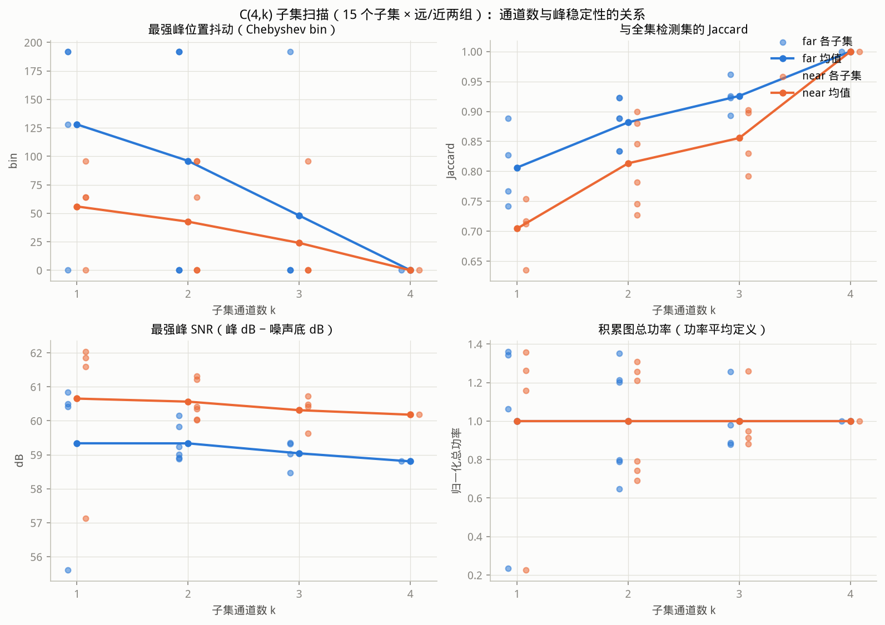
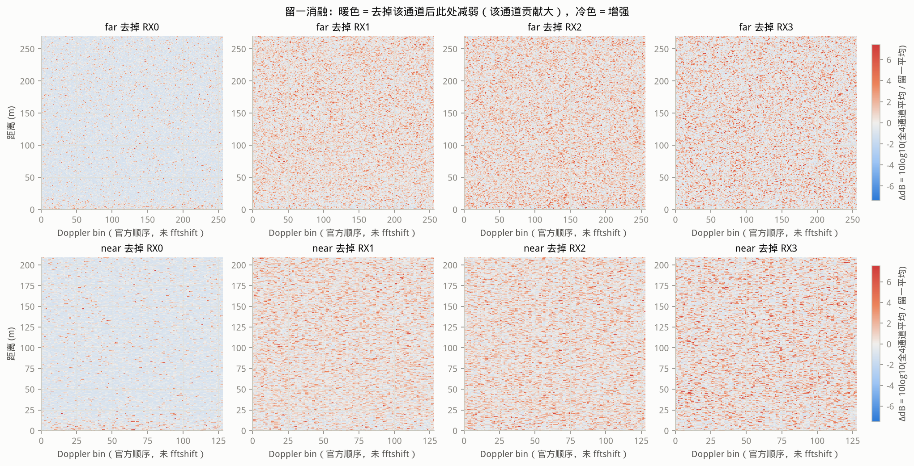
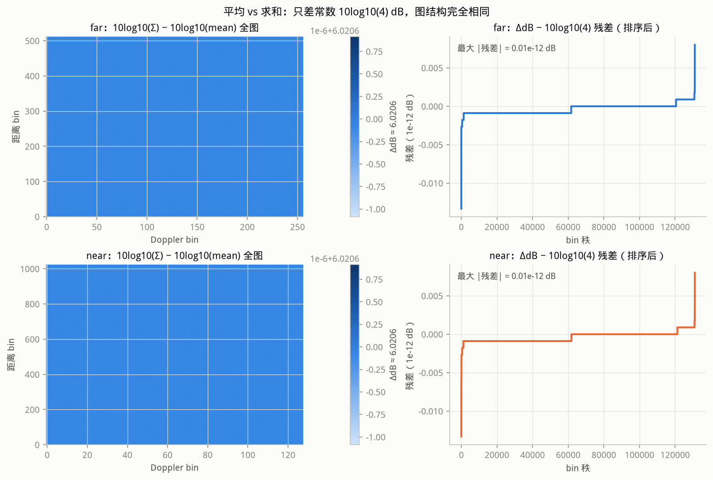

# a100-rx-ablation — CTASI-A100 四接收通道非相干积累的通道消融研究

针对 CTASI-A100 四个接收通道（RX0..RX3）的**功率域非相干积累**做系统的通道消融：
官方 MATLAB 平台把"非相干积累"定义为 `RVimage = Σ_ch |velFftData(:,:,ch)|² / 4`
（功率**平均**），本项目的全部 5 个社区项目都在直接使用它，但没有人回答过
"少一个通道损失什么 / 结果是否被单通道主导 / 平均和求和差在哪"。本项目用仓内
官方示例数据（远波 f0 / 近波 f1 各 4 通道）在严格复刻官方链路的 Python 实现
上量化回答这些问题。

> 诚实红线：四通道采集是否严格同步未知（未见硬件文档），本项目**只在功率域**
> 工作，不做任何通道间相位 / 同步性 / 标定断言。

## 项目目标

1. 用 Python 逐条复刻官方 MATLAB 链路（.hxx 解析 → ADC 解包 → 2D-FFT → 功率
   平均 RVimage），并与官方结果 JPG、社区既有验证项目交叉核对；
2. 单通道画像：每个通道的峰表、总能量、对积累结果的贡献占比；
3. C(4,k) 全部 15 个通道子集扫描：最强峰位置抖动、检测集 Jaccard、最强峰 SNR；
4. 留一消融（leave-one-out）：去掉某通道后哪些峰消失 / 减弱；
5. 平均 vs 求和：证明两者只差常数 10log10(k) dB，避免社区误读。

## 数据说明

全部为仓库内置官方示例数据（本项目**不复制数据**，按路径引用）：

`ADC数据采集/示例adc数据和结果/`（相对仓库根，下同）

| 数据集 | 文件（后缀 _0.._3 = RX0..RX3） | sha256（前 16 位） |
|---|---|---|
| 远波 f0 | `adc_远波_20260512135827_f0_{0..3}_*.txt` | bba39d6f30c7c153 / 33d6b42ec6458934 / c58910a170558675 / 80ebc8a7f1735612 |
| 近波 f1 | `adc_近波_20260512141857_f1_{0..3}_*.txt` | 36db22359f0bc902 / 4fb120427111cdda / 05f3a38d9297f35c / 134e89fb95ae8e2d |

- 格式：无头逗号分隔 uint32 文本，每文件 131073 值 = 载荷 131072 + 1 个尾部
  多余值。官方 `load_adc_data.m` 在解包**前**截断到前 131072 个字——**首个值
  是有效样本**，丢弃的是末尾多余值（本项目测试锁定该语义）。
- 官方结果图（定性对照）：同目录 `远波4个通道非相干积累.jpg`、
  `近波4个通道非相干积累.jpg`，是官方链路 RVimage 的 **3D mesh 渲染**。
- **离线分析，未做硬件实测**。单批次静态场景（近距强反射体 + 无人机目标 +
  DDMA 镜像结构），结论的外推范围见"局限"。

### 与官方 JPG 的对照说明

同一数据 + 同一官方定义 → 同一 RVimage。但 JPG 无法逐像素对拍，原因：
(a) 它是视角相关的 3D mesh 渲染（遮挡、无色标刻度），bin 坐标不可从像素反演；
(b) colormap/dB 归一化未知；(c) JPEG 有损压缩。因此对照是**结构级**的：

| 检查项 | 官方 JPG（本项目程序化统计） | 本项目复现 |
|---|---|---|
| 远波 | 亮度前 0.5% 的亮簇 4 个；红色 `ro` 标记 30 px | 最强结构集中在 2 个距离位置（bin 5 / bin 9）× DDMA 镜像速度 ≈ 4 个主导亮斑 |
| 近波 | 亮簇 4 个；红色标记 53 px | 最强结构集中在 bin 12 一个距离位置 × 镜像速度 ≈ 4 个主导亮斑 |

并排对照图见 `figures/fig7_official_jpg_compare.png`。另一个更硬的交叉核对：
社区项目 a100-matlab-adc-pipeline-validation 在同一批远波数据上 CFAR 检出
6.29 m（0 基 bin 12）/ Doppler 0 目标、报告 128.46 dB——该项目未除官方 FFT
scalar（10log10(255²·63²) = 84.12 dB），换算后 128.46 − 84.12 = 44.34 dB，
本项目复现链路在同 bin 实测 44.3 dB，**逐 bin 对上**；其检出的 Doppler 镜像
集合 {0, +32, −128} 与本项目行 12 的强 Doppler bin {0, 32, 128} 一致。

## 方法

### 官方链路复刻（`src/rx_ablation/pipeline.py`，逐条对应 .m 行为）

| 官方文件 | 行为 | 本项目 |
|---|---|---|
| `init_function/get_radar_paramete.m` | `adc_sample_num`：`dec_factor>1` 时 `round(窗口×fs/dec)+1`，**否则无 +1**；再钳位到 `rng_nfft` | 远波 `round(40.8×25)=1020`（注意：不是 1021，官方代码 `dec_factor=1` 走无 +1 分支）；近波 `round(102.4×25)=2560 → 钳位 2048` |
| 同上 | `rng_res = 3e8/2/(BW/rampup×窗口)/1e6`，`V_res = 0.5·3e8/f0×(1/fram_time/1e-3)` | 远波 0.5270 m/bin、0.1600 m/s/bin（名义）；近波 0.2044、0.1419 |
| `init_function/load_adc_data.m` | 截断/补零到 `rng_nfft/2 × nchirp` 个字，列优先 reshape `[rng_nfft/2, nchirp]`，转置为 chirp 行 | `reshape(order='F')` + `.T`，测试锁定 |
| `init_function/adc_mem_2_real_fixed.m` | 每字高 16 位在前、低 16 位在后，两补码 int16 | `(w>>16, w&0xFFFF)` 交错，测试锁定 |
| `FFT/do_fft_2d.m` | 距离维 `hann(adc_sample_num)` 只作用于前 `adc_sample_num` 样本 → FFT 到 `rng_nfft`（补零）除以 `rng_fft_scalar=255` → 取前 `rng_nfft/2` 行 → 速度维 `hann(nchirp)` → FFT 到 `vel_nfft` 除以 `vel_fft_scalar=63` | 一致（`hann` 用对称窗 = MATLAB 默认） |
| `ct_signal_processing_main_simple_CTASIA100.m` | `RVimage = Σ_ch power(abs(velFftData(:,:,ch)),2) / nvirtual_array` | `accumulate_power` = 所选通道功率图**平均** |

### 消融指标定义（`metrics.py` / `ablation.py`）

- **峰检测**：局部极大（3×3）+ 阈值（噪声底 + 20 dB，噪声底 = dB 图中位数）
  + 最小分离 NMS（4,4 bin）。全流程显式统一参数；margin 在 12–28 dB 区间
  检出数 19–66，结论方向不敏感。bin 坐标一律 0 基（MATLAB 官方 1 基，差 1）。
- **最强峰抖动**：子集最强峰相对全 4 通道最强峰的 (Δrng, Δvel) bin。
- **Jaccard**：两组峰集合在容差 (3,3) bin 内贪心匹配，|匹配|/|并集|。
- **SNR**：最强峰 dB − 噪声底 dB（中位数），按子集图各自计算。
- **留一差值图**：`10log10(mean_全4) − 10log10(mean_留一)`，>0 = 去掉后减弱。
  注意官方**平均**归一化下 k:4→3 会带来 ±10log10(4/3)=1.25 dB 的稀释项，
  通道特异性贡献要看峰位 ΔdB 与 Jaccard，而非全图均值。
- **能量恒等式**：Σ 单通道功率图 == 全通道求和图（功率域线性，若误用复幅度
  则出现交叉项破坏恒等式）。

## 开发环境

- WSL2 / Ubuntu 24.04，Python 3.12（`/home/cnj/openSource/.venv-a100/bin/python`）
- numpy 2.5.3 / scipy 1.18.1 / matplotlib 3.11.2（Agg 出 PNG）/ pytest 8.x
- 中文字体：WenQuanYi Micro Hei（图内中文标签）

## 运行方法

```bash
cd community/projects/a100-rx-ablation
# 一键复现：加载数据 → 官方链路 → 5 组实验 → figures/*.png + results/*.csv + results/summary.md（约 10 s）
PYTHONPATH=src python -m rx_ablation.cli
# 数据/配置路径参数化（默认仓内相对路径，不复制数据）
PYTHONPATH=src python -m rx_ablation.cli --data-dir /path/to/adc --cfg-dir /path/to/hxx
# 测试（合成数据为主 + 真实数据冒烟，约 2 s）
python -m pytest tests -q
```

目录结构：`src/rx_ablation/`（pipeline / metrics / ablation / plots / cli）、
`tests/`（5 个测试文件 28 个用例）、`figures/`（7 张 PNG，可一键重生成）、
`results/`（10 个 CSV + summary.md，均可一键重生成）。

## 结果展示

### 1. 官方定义复现（图 1 / 图 7）

远波 4 通道功率平均图（512×256）：最强峰 (rng 5, vel 0) = 53.8 dB（2.63 m），
其 DDMA 镜像 (5, 192)=53.5 / (5, 128)=53.0 dB 仅差 0.3–0.7 dB；次强结构
(9, 32)=48.3 dB（4.74 m）。近波（1024×128）：最强 (12, 0)=56.0 dB（2.45 m）。
与官方 JPG 结构级一致（见"数据说明"）。




### 2. 单通道画像（图 2 / 图 6）——结果是否被单通道主导？

**不是被某一个强通道主导，而是被一个弱通道拖累。**两组数据一致：

| 通道 | 远波能量占比 / max dB | 近波能量占比 / max dB | 主导峰处功率占比（远/近） |
|---|---|---|---|
| RX0 | **5.8%** / 45.7 dB | **5.6%** / 48.0 dB | **0.2%–2%** / 0.25%–1.3% |
| RX1 | 34.0% / 55.6 dB | 33.9% / 57.9 dB | 16%–44% / 12%–43% |
| RX2 | 33.6% / 55.7 dB | 31.5% / 57.6 dB | 18%–42% / 17%–40% |
| RX3 | 26.6% / 55.2 dB | 28.9% / 57.4 dB | 16%–35% / 20%–60% |

RX1/2/3 在各峰处的占比随峰轮换（无固定主导），RX0 在全部主导峰处贡献接近零；
通道间逐 bin 功率相关系数极低（RX1-3 两两 0.10–0.15 线性域），噪声近似独立。




### 3. 子集扫描（图 4）：积累通道数与峰稳定性

15 个子集 × 远/近两组（完整表 `results/{far,near}_subset_scan.csv`）：

| 指标（均值） | k=1 | k=2 | k=3 | k=4 |
|---|---|---|---|---|
| 远波 Jaccard | 0.81 | 0.88 | 0.93 | 1.00 |
| 近波 Jaccard | 0.71 | 0.83 | 0.86 | 1.00 |
| 远波最强峰抖动 | 最大 (3,128) bin（RX0） | 0* | 0* | 0 |
| 近波最强峰抖动 | 最大 (10,64) bin（RX0） | 0* | 0* | 0 |
| 远波最强峰 SNR | 55.6（RX0）–60.8 dB | 58.9–60.1 | 58.5–59.3 | 58.8 |

\* 抖动为 0 指**距离 bin 不再移动**；部分子集最强峰在 0.3–0.7 dB 的 DDMA
镜像孪生峰之间翻转（远波 vel 0↔192，近波 vel 0↔96），这是镜像峰近并列造成
的并列选择，不是定位漂移。



### 4. 留一消融（图 3）

去掉 RX0：top5 峰普遍**增强** 0.7–1.2 dB（少了一个只贡献噪声的通道被 4 除稀释）
且 Jaccard 保持 0.90+；去掉 RX1/2/3 任一：Jaccard 降至 0.79–0.96，top5 峰
减弱或镜像翻转（如近波去 RX3 后第 5 峰 +2.7 dB 翻转）。可解释结论：
**这批数据的"3 通道等效"——RX0 在功率域近乎失效，RX1/2/3 才是有效积累集**；
若在真实系统上复现此画像，应优先排查 RX0 的射频/天线通道。



### 5. 平均 vs 求和（图 5）

`10log10(Σ)` − `10log10(mean)` 在全图每个 bin 恒等于 **10log10(4) = 6.0206 dB**
（实测最大偏差 1.33e-14 dB，机器精度）；功率恒等式 Σ单通道 = 总和图
max_rel_err = 0。求和只是均值图的 dB 平移，**图结构完全相同**，社区引用官方
"非相干积累"数值时务必注明归一化方式。



## 结论（给社区）

1. **位置稳定性**：k≥2 个通道即可锁定最强峰距离 bin（抖动 0）；单通道
   （尤其弱通道）会移位 3–10 个距离 bin 并跳到别的 DDMA 镜像 bin。
2. **检测集稳定性随 k 单调上升**：单通道 Jaccard ≈ 0.71–0.81，k=3 ≈ 0.86–0.93，
   k=4 = 1；即单通道会漏掉积累后约 20–30% 的检测集，每多一个通道约 +0.05–0.1。
3. **不要把"积累通道数"读成"SNR 抬升 10log10(N) dB"**：在官方功率平均定义、
   以中位数噪声底为参照时，本数据上 k=4 的峰-底 dB 差甚至比最佳单通道低
   1.6–2.0 dB（弱通道稀释 + 平均抬高噪声底中位数）；非相干积累的真实收益是
   **噪声方差收缩带来的虚警/杂散峰抑制与检测稳定性**，体现在 Jaccard 与抖动上。
4. **先做通道体检再积累**：本项目两批数据 RX0 能量占比仅 ~6%、主导峰占比
   <2%，4 通道积累实际等效 3 通道。建议社区在新装设备上先跑本项目 CLI 的
   单通道画像（`*_single_channel_peaks.csv` / `*_peak_channel_shares.csv`）。
5. **归一化别混淆**：官方"平均"与"求和"差常数 6.0206 dB（k=4），仅影响
   dB 标尺不影响任何检测结论。

## 局限

- 离线分析、未硬件实测；仅 1 批静态场景数据（近距强反射 + 无人机 + DDMA
  镜像），量化数字不能直接外推到其他场景/固件。
- 通道同步性未证实 → 全部结论限于功率域；未做任何相位域/相干积累断言。
- 公开 hxx 暴露 TDM 风格 `tx_groups` 而数据呈 DDMA 结构（同
  a100-matlab-adc-pipeline-validation 的发现），物理速度不可靠，速度轴仅按
  名义 V_res 标注。
- 峰检测为局部极大 + 固定阈值（非 CFAR），参数已显式披露；弱结论（如镜像
  峰并列翻转）对 margin 敏感，已在图注中标明。
- 官方 JPG 为 3D mesh 渲染，只能做结构级对照，无法逐像素对拍。
- 相关矩阵基于全 bin 统计，被噪声 bin 主导，只用于"近似独立"的粗判断。

## 与现有社区项目的关系

- 5 个既有项目（a100-indoor-cart-mti / a100-indoor-outdoor-radar-analysis /
  a100-matlab-adc-signal-processing / a100-matlab-adc-pipeline-validation /
  a100-perimeter-vehicle-radar-analysis）在各自链路中**直接使用 4 通道功率
  积累**（如 perimeter 的 `doppler_fft.m`: `rdPower = mean(abs(rdCube).^2, 3)`），
  但均未量化单通道贡献与通道子集稳定性——本项目补上这一维度。
- a100-indoor-outdoor 与 a100-perimeter 用 MATLAB 做过积累可视化，但无消融
  实验；a100-matlab-adc-pipeline-validation 验证了链路正确性（本项目与其
  交叉核对过数值），同样不涉及通道消融。
- 与 open PR #66（`fix(community): reject non-finite ADC payloads`）、#77
  （`docs: document both ADC session and flat file layouts`）主题不重叠。

## 作者

chennaji9
