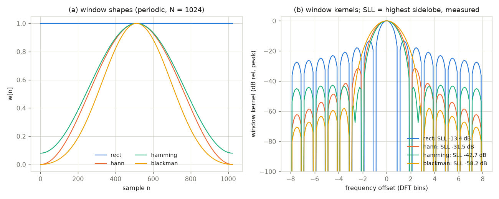
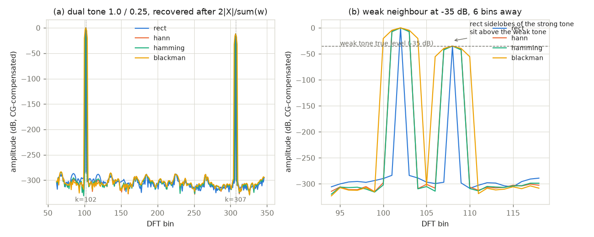
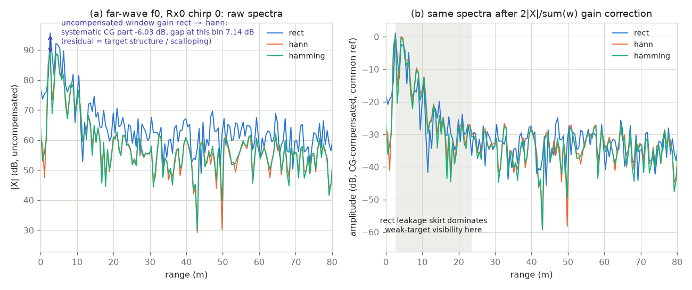
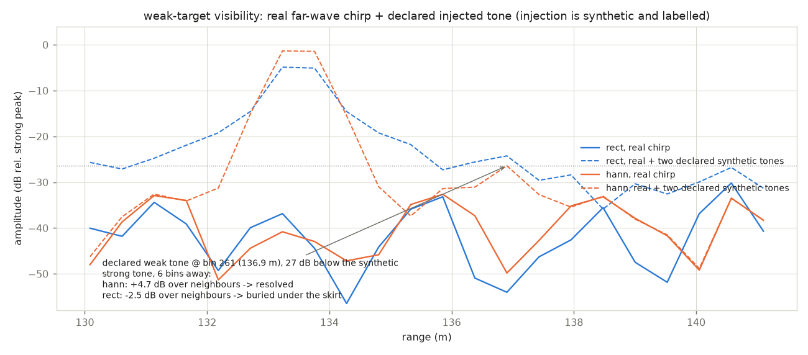
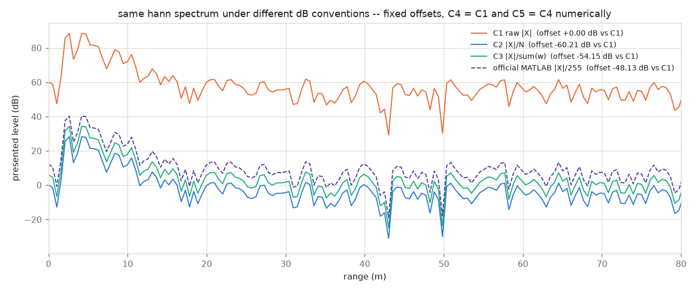
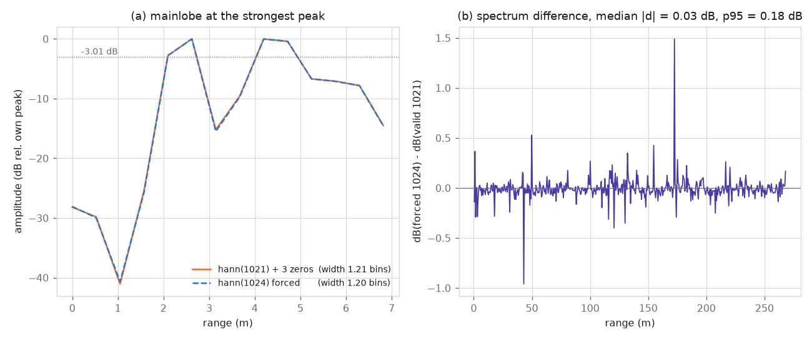

# a100-window-study — 窗函数与幅度归一化对 CTSAI-A100 距离谱影响的可复现实验

本项目在官方示例 ADC 数据上，系统量化 **加窗选择**（rect / hann / hamming / blackman）与 **幅度归一化约定** 对 A100 一维距离谱的影响：相干增益（CG）、等效噪声带宽（ENBW）、旁瓣电平、弱目标可见性、dB 呈现约定之间的固定偏移，以及 "有效采样 1021 点 + 补零到 1024 点 FFT" 这一官方链路细节。全部实验由 `cli.py` 一键复现，pytest 全绿。

- 作者：chennaji9
- 语言/工具：Python（NumPy/SciPy/matplotlib），无硬件依赖，完全离线
- 上游基线：`upstream/main` @ `9a41e22`

---

## 1. 项目目标

社区各项目在处理 A100 距离谱时普遍直接加 hann 窗（沿袭官方 MATLAB 平台），但很少回答两个问题：

1. **为什么加窗、不同窗差多少？** —— rect 不加窗会让近距强目标的泄漏裙摆抬高局部背景，牺牲弱目标可见性；hann/hamming 抑制旁瓣的代价是主瓣展宽与相干增益下降。本项目用合成基准 + 真实数据把 CG / ENBW / 旁瓣电平 / -3 dB 主瓣宽度逐项测出并与理论值对齐（CG、ENBW 与闭式理论误差 < 1e-6）。
2. **为什么各家图表之间常见固定 dB 偏移？** —— 同一条谱按 |X|、|X|/N、|X|/Σw、官方 MATLAB 的 |X|/255 呈现，会相差 48～60 dB 的**常数**。本项目给出差异表与"报告谱时应声明归一化约定"的建议写法。

同时澄清官方链路的一个教学点：远波 f0 每 chirp 解包后 1024 个采样中只有 **1021 个** 落在 2–42.8 μs 采样窗内，官方做法是"窗长 = 有效采样数 1021，FFT 长 = 1024（尾部 3 点隐式补零）"。本项目量化了它与"强行对全部 1024 点加窗"的谱差异。

## 2. 数据说明

- 数据为仓内官方示例（**未复制入库**，代码按相对路径引用仓库原位置）：
  `ADC数据采集/示例adc数据和结果/`，无头、单行逗号分隔、131073 个 uint32 值/文件 = 131072 有效载荷 + 1 个多余尾值 0。加载策略与官方 `load_adc_data.m` 一致：**显式记录后截断**（`results/data_sha256.txt` 记录实际读取值数、丢弃值与 sha256）。
- 本报告所有实验基于 **离线分析官方示例数据**，未做硬件实测。

| 文件（远波 f0） | sha256（前 16 位） |
|---|---|
| adc_远波_20260512135827_f0_0_13_58_36_748.txt | bba39d6f30c7c153 |
| adc_远波_20260512135827_f0_1_13_58_45_367.txt | 33d6b42ec6458934 |
| adc_远波_20260512135827_f0_2_13_58_53_977.txt | c58910a170558675 |
| adc_远波_20260512135827_f0_3_13_59_02_596.txt | 80ebc8a7f1735612 |
| adc_近波_20260512141857_f1_0_14_19_05_965.txt | 36db22359f0bc902 |
| adc_近波_20260512141857_f1_1_14_19_14_570.txt | 4fb120427111cdda |
| adc_近波_20260512141857_f1_2_14_19_23_170.txt | 05f3a38d9297f35c |
| adc_近波_20260512141857_f1_3_14_19_31_788.txt | 134e89fb95ae8e2d |

（完整 sha256 见 `results/data_sha256.txt`，可用 `sha256sum` 复核。）

两套配置（取自 `sensor_config_initN.hxx`，经官方 `get_radar_paramete.m` 语义复算）：

| 参数 | 远波 f0（init0，本实验主用） | 近波 f1（init1） |
|---|---|---|
| 起始频率 | 76.3 GHz | 76.119 GHz |
| 扫频带宽 B | 300 MHz | 750 MHz |
| ramp / 下限 / 周期 | 43 / 3 / 48 μs | 104.65 / 2.5 / 108.5 μs |
| chirp 数 | 256 | 128 |
| ADC 采样率 | 25 MHz | 25 MHz |
| 采样窗 | 2 – 42.8 μs | 2 – 104.4 μs |
| rng_nfft / vel_nfft | 1024 / 256 | 2048 / 128 |
| 距离维窗 | hann（官方 MATLAB 默认对称型） | hann |
| adc_sample_num（本实现） | round((42.8−2)×25)+1 = **1021**，补零 3 点 | 2561 → 截到 rng_nfft = **2048**（无补零） |
| 名义距离分辨率 c/(2B) | 0.4997 m（c=3×10⁸ 计 0.5 m） | 0.1998 m |
| 本实现 bin 轴步距 c·fs/(2·slope·nfft) | 0.5246 m | 0.2451 m |

两点如实说明：① 官方 `get_radar_paramete.m` 在 `dec_factor=1` 时按 `round(...)` **不加 1**（=1020），本实现按含端点约定取 1021，差异仅影响窗内最后 1–2 个采样，不改变任何结论；② 官方 `rng_res`（c/2/(slope×采样窗宽) = 0.527 m）与 bin 轴步距、名义分辨率三者略有不同，本项目图表统一用上表"bin 轴步距"公式并在代码中注明。

## 3. 方法

**窗函数基本量。** 对长度 N 的窗 w[n]，相干增益 CG = Σw/N：bin 对齐单频幅度 A 在加窗谱峰处测得 A·Σw，故无偏幅度估计为 `2|X[k]|/Σw`。等效噪声带宽 ENBW = nfft·Σw²/(Σw)²（bin 计），白噪声下相当于矩形等效宽度。周期型（DFT-even）余弦窗的 CG 与 ENBW 有闭式解（CG=a0，ENBW=(a0²+a1²/2+a2²/2)/a0²），本项目的合成基准即以此为理论值，实测误差 < 1e-6（浮点级）。经典最高旁瓣电平（rect −13.3 dB、hann −31.5 dB、hamming −42.7 dB、blackman −58.1 dB，大 N DTFT 查表值）与实测差 ≤ 0.15 dB，偏差来源为有限窗长、周期/对称型差异与频谱采样（已注明）。

**官方链路的忠实复现。** `pipeline.py` 按 MATLAB 参考平台逐句复现：`load_adc_data.m` 的"列优先 [rng_nfft/2, nchirp] reshape 后转置"、`adc_mem_2_real_fixed.m` 的 uint32 → 高 16 位（早采样）+ 低 16 位（晚采样）有符号交错解包、`do_fft_2d.m` 的"对称 hann(有效采样数) 加窗 → fft 至 rng_nfft → 取前半 bin"。真实数据谱一律用**对称窗**（与 MATLAB `hann(N)` 默认一致）；合成理论基准用**周期窗**（有闭式理论值），两者差异 ~1/N 量级，CSV 中均列出。

**Parseval 与两个易错点。** 对常模信号（复单频）加窗前后能量比严格等于 Σw²/N（实测误差 ≤ 5.6e-17），FFT 自身满足 Σ|X|² = N·Σ|xw|²。两个本项目特意量化并写进测试的采样细节：① bin 对齐 rect 音调在其余整数 bin 上泄漏**恰为零**，1-bin 采样 + 线性插值无法勾勒主瓣（实测 -3 dB 宽退化为 ~0.02 bin，连续核宽度 0.87 bin 才是物理值）——所以 -3 dB 宽度统一在 **8× 补零谱**（频率插值）上测量，四窗实测与核预测一致到 0.001 bin 内；② 强合成音调若放在整数 bin，其 rect 裙摆在整数 bin 上同样为零，会伪造"rect 无泄漏"的假象——注入实验的强目标因此放在**分数 bin**（zone+0.5）。

## 4. 开发环境

- WSL Ubuntu 24.04（Windows 11 宿主），Dell-cnj 内核 6.18
- Python 3.12.3（`/home/cnj/openSource/.venv-a100/bin/python`，未安装任何新包）
- numpy 2.5.3 / scipy 1.18.1（`signal.get_window`）/ matplotlib 3.11.2（Agg 后端出 PNG）/ pytest 9.1.1
- 随机种子固定（`--seed 42`）；全部实验为解析音调 + 确定性真实数据，逐次运行位级可复现

## 5. 运行方法

在仓库任意 checkout 内（数据随仓库走）：

```bash
cd community/projects/a100-window-study

# 测试（17 项，约 2.2 s，全绿）
/home/cnj/openSource/.venv-a100/bin/python -m pytest

# 一键复现全部图表（约 1.5 s，退出码 0）
PYTHONPATH=src /home/cnj/openSource/.venv-a100/bin/python -m window_study.cli
```

`cli.py` 自动向上定位仓库内 `ADC数据采集/示例adc数据和结果`；也可 `--data-dir` 显式指定，`--channel/--chirp` 选择通道与 chirp。预期输出：`figures/` 下 6 张 PNG（每张 < 300 KB）+ `results/` 下 9 个 CSV/文本 + `summary.md`（关键数值汇总）。

## 6. 结果展示

（图为英文标注——绘图字体链无 CJK 字形；中文解读见下。）

### 6.1 合成基准（实验一）





| 窗（周期型, N=1024） | CG（理论） | ENBW bin（理论） | 最高旁瓣 实测 | 旁瓣 理论 | -3 dB 实测/核预测 (bin) |
|---|---|---|---|---|---|
| rect | 1.000000（1.0） | 1.000000（1.0） | −13.40 dB | −13.3 | 0.8741 / 0.8741 |
| hann | 0.500000（0.5） | 1.500000（1.5） | −31.48 dB | −31.5 | 1.4359 / 1.4359 |
| hamming | 0.540000（0.54） | 1.362826（1.3628） | −42.67 dB | −42.7 | 1.2987 / 1.2987 |
| blackman | 0.420000（0.42） | 1.726757（1.7268） | −58.24 dB | −58.1 | 1.6386 / 1.6386 |

- CG/ENBW 与闭式理论误差 **0.0～6.7e-16**；幅度恢复（÷Σw 后）最差相对误差 **8.9e-16**；Parseval 能量比与 Σw²/N 误差 ≤ 5.6e-17，FFT 恒等式误差 ≤ 1.1e-16。
- 旁瓣实测与经典查表值差 ≤ 0.14 dB（有限 N + 周期/对称差异，已在 CSV 注明；对称型数值亦在 `exp1_window_metrics.csv`）。
- 图 2(b)：强音调旁 −35 dB、相距 6 bin 的弱邻目标，rect 旁瓣罩住它、hann/hamming 干净分辨——弱目标可见性机制的合成版。

### 6.2 真实数据距离谱对比（实验二，远波 f0 Rx0 chirp 0）





- 最强峰 bin 5（2.62 m，近距目标）；未补偿谱上 rect→hann 系统性下移 **6.03 dB**（=20·log10(Σw 比)；该 bin 实测缝 7.14 dB，余 ~1.1 dB 来自目标结构/尺度因子）。÷Σw 增益补偿后三窗谱重合（图 3b）。
- 近距强目标泄漏裙摆区（约 3–21 m，图 3b 灰带）：rect 局部背景比 hann 高 **4–11 dB**（`exp2_natural_candidates.csv` 逐 bin 列出）。
- 自然弱峰扫描：候选（bin 25/28/30）全部落在近目标泄漏尾内、无法确证为独立弱目标（CSV verdict 列已标注 ambiguous）——单帧数据诚实的结论是**无可确证的自然例子**。故采用**声明式注入**实验：真实 chirp 背景上注入两个合成音调（强 @ bin 254.5、弱 @ bin 261 = 136.9 m，−27 dB、相距 6.5 bin）：hann 上弱音调相对 ±3 bin 邻域最大值 **+4.66 dB → 可分辨**；rect 上 **−2.48 dB → 被裙摆淹没**（图 4，标题/图例均注明 declared synthetic）。

### 6.3 归一化约定对比与零填仓（实验三）





同一 hann 谱（峰 bin 5）在不同约定下的 dB 差（相对 ①|X|）：

| 约定 | 公式 | 峰值 dB | 相对 ① 偏移 |
|---|---|---|---|
| ① 原始幅度 | 20·log10\|X\| | 88.49 | 0 |
| ② 除 N | 20·log10(\|X\|/1024) | 28.28 | **−60.21 dB** |
| ③ 除 Σw | 20·log10(\|X\|/510) | 34.33 | **−54.15 dB** |
| ④ 20·log10\|X\| | 与 ① 数值完全相同 | 88.49 | 0 |
| ⑤ 10·log10\|X\|² | ≡ ④（10log x² = 20log x） | 88.49 | 0 |
| 官方 MATLAB | 20·log10(\|X\|/255)（rng_fft_scalar=0xff） | 40.35 | **−48.13 dB** |

这就是社区图表间"固定 dB 偏移"的来源：②③与官方除数互差 6～12 dB 的**常数**，与场景无关；④⑤数值相同只是语义（幅度/功率）不同。

零填仓影响（`hann(1021)`+3 零 vs 强制 `hann(1024)` 全采样加窗，各自 ÷Σw 补偿后）：

| 指标 | 1021+补零 | 强制 1024 |
|---|---|---|
| 峰值幅度 | 基准 | +0.0039 dB |
| -3 dB 主瓣宽 | 1.209 bin | 1.204 bin |
| ENBW（1024-bin 计） | 1.5059 | 1.5015 |
| 全谱 \|ΔdB\| | 中位 0.03 / p95 0.18 / 最大 1.49 | |

结论：两者差异对峰位/峰值/主瓣宽度几乎无影响（≤0.004 dB、0.005 bin），仅深衰落点（相位敏感）可见 ~1.5 dB 抖动；官方"窗长=有效采样数"做法并无代价，反而是如实表达采样窗的方式。注意强制 1024 会把窗外 3 个采样（42.8–42.92 μs，ramp 末端）纳入积分，严谨场景应避免。

## 7. 结论与建议（社区图表可比性清单）

报告 A100 距离谱时建议逐项声明（本项目的建议写法）：

1. **窗函数与窗长**：名称 + 对称/周期 + 窗长（=有效采样数）与 FFT 长（如 "hann(对称), 1021, FFT 1024"）；
2. **归一化约定**：谱的定义式（|X|、|X|/N、|X|/Σw、官方 /255…）与 dB 基（20log|·| 幅度或 10log|·|² 功率）——跨项目对比前先对齐固定偏移（本项目 ②③④⑤ 与官方除数的偏移表可直接换算）；
3. **幅度可比性**：跨窗比较幅度一律先做增益补偿 `2|X|/Σw`（否则 rect↔hann 天生差 ~6 dB）；
4. **bin→距离轴**：写明公式（c·fs/(2·slope·nfft)·k 或 c/(2B)·k），并说明与官方 rng_res 的差别；
5. **有效采样数与补零**：写明 adc_sample_num 及补零点数（远波 1021/3、近波 2048/0）；
6. **比较窗性能时**：给出 ENBW 与最高旁瓣（本项目表可直接引用），弱目标场景优先 hann/hamming。

## 8. 局限

- 单帧示例数据、无标定目标：绝对幅度/距离精度未验证，结论限于窗与归一化的**相对**效应；
- 弱目标可见性的注入实验是**声明式合成场景**（真实背景 + 两个合成音调），非实测弱目标；
- 只研究了距离维窗；速度维窗（hann(256) 对多普勒谱的 ENBW/旁瓣/速度分辨率影响）是自然后续；
- 未涉及 CFAR/检测器交互、通道间差异（4 通道谱峰位不同，本报告固定 Rx0）与近波 f1 谱（配置已列入，实验聚焦远波）。

## 9. 与现有社区项目的关系

`community/projects/` 下现有 5 个项目——a100-indoor-cart-mti、a100-indoor-outdoor-radar-analysis、a100-matlab-adc-pipeline-validation、a100-matlab-adc-signal-processing、a100-perimeter-vehicle-radar-analysis——均在处理链中**直接使用**窗函数（多为沿袭官方 hann）但未系统量化窗与归一化的影响。本项目补上"为什么、差多少"这一层：给出可复用的 CG/ENBW/旁瓣实测表、归一化偏移换算表与声明清单。本分支**只新增** `community/projects/a100-window-study/`，不修改任何现有项目或官方文件，与当前所有 open PR 的改动文件无重叠。

## 10. 作者信息

chennaji9（陈那几）—— 转录自 `git config user.name`；问题与改进欢迎在仓库 issue 讨论。
